# Diagrama UML - Casos de Uso

## Actores
- **Captador (Anfitrión)**: usuario que registra prospectos en terreno.
- **Administrador**: gestiona usuarios, actividades y prospectos.
- **Prospecto**: futuro estudiante que se registra en el sistema.

## Casos de uso

### Autenticación
- Registrar usuario (captador o admin)
- Iniciar sesión (redirección por rol: captador → /captador, admin → /admin)

### Gestión de prospectos (Captador)
- Capturar prospecto (con o sin actividad asociada)
- Listar mis prospectos capturados
- Ver detalle de prospecto
- Ver inscritos por actividad asignada

### Gestión de prospectos (Administrador)
- Listar todos los prospectos (con filtros: fecha, actividad, tipo, mes, día, periodo)
- Exportar prospectos a CSV
- Detectar prospectos duplicados entre actividades
- Ver detalle de prospecto

### Gestión de actividades (Administrador)
- Crear actividad (con validación de ventana horaria)
- Editar actividad
- Asignar captador a actividad
- Desasignar captador de actividad
- Ver captadores asignados por actividad
- Generar código QR para actividad

### Gestión de actividades (Captador)
- Ver actividades asignadas (con fechas, ubicación, tipo)
- Ver inscritos en mis actividades

### Análisis
- Ver gráficos por actividad, región, género, edad, carrera/escuela

## Diagrama (Mermaid)

```mermaid
graph TD
  A[Captador] --> B(Registrar usuario)
  A --> C(Iniciar sesion)
  A --> D(Capturar prospecto)
  A --> E(Ver mis prospectos)
  A --> F(Ver inscritos por actividad)
  A --> G(Ver mis actividades asignadas)
  F2[Administrador] --> B
  F2 --> C
  F2 --> H(Gestionar usuarios)
  F2 --> I(Crear actividad)
  F2 --> J(Editar actividad)
  F2 --> K(Asignar captador)
  F2 --> L(Desasignar captador)
  F2 --> M(Ver captadores por actividad)
  F2 --> N(Ver todos los prospectos)
  F2 --> O(Exportar CSV)
  F2 --> P(Detectar duplicados)
  F2 --> Q(Ver gráficos)
  A --> Q
  F2 --> R(Generar QR)
  P2[Prospecto] --> D
```

`, "docs/fase2-desarrollo/grupales/Evidencias de documentación/uml-casos-uso.md")