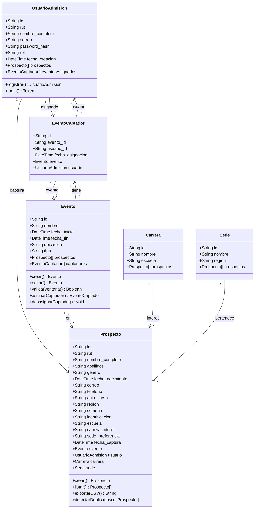
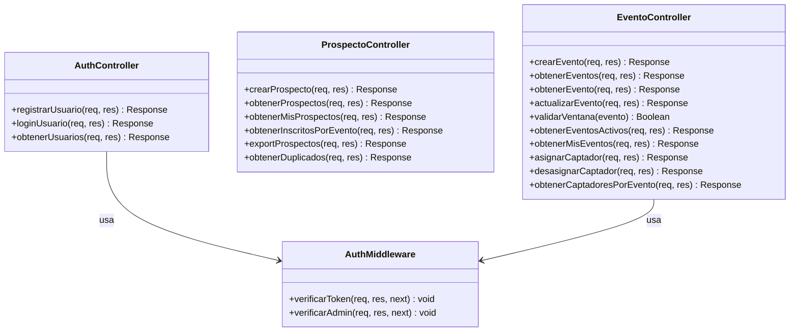
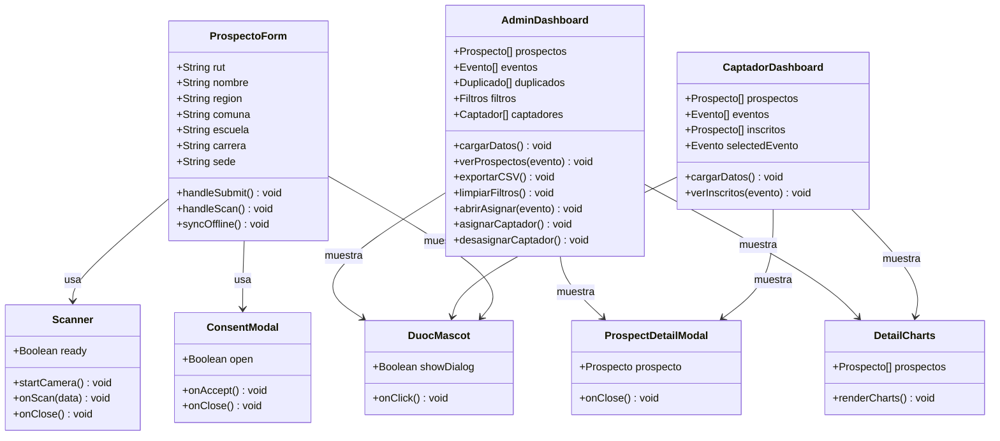

# Diagrama UML - Clases

## Descripción
Diagrama de clases del sistema basado en el modelo de datos (Prisma) y la arquitectura del backend.

## Clases del dominio

## Clases de control (Backend)

## Clases de frontend (React)

`, "docs/fase2-desarrollo/grupales/Evidencias de documentación/uml-clases.md")