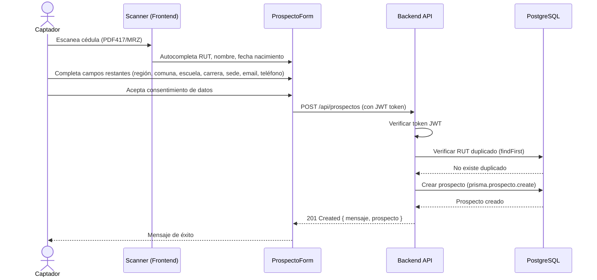
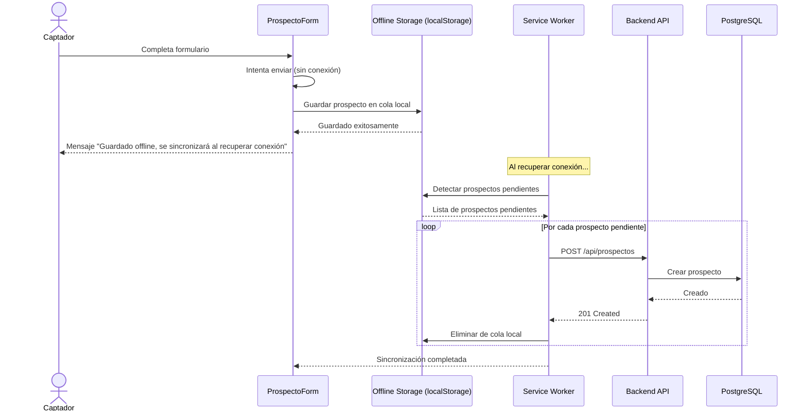
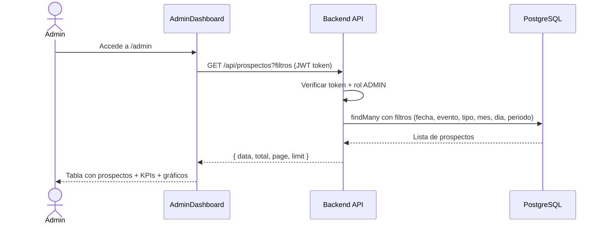
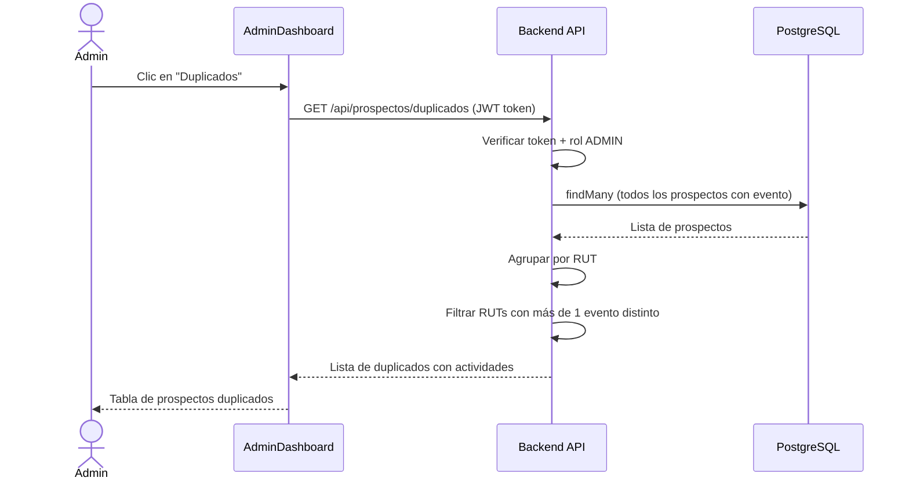
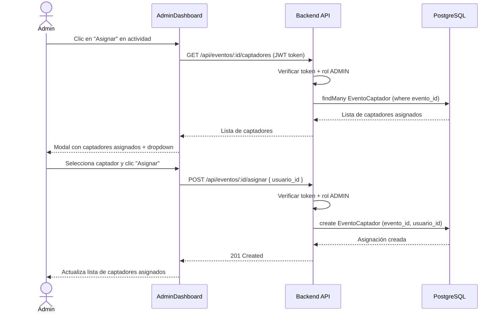
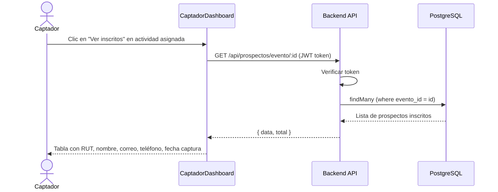

# Diagrama UML - Secuencia

## Descripción
Diagrama de secuencia para el flujo principal de captura de un prospecto.

## Flujo 1: Captura de prospecto (con conexión)

## Flujo 2: Captura de prospecto (sin conexión - offline)

## Flujo 3: Listar prospectos en panel admin

## Flujo 4: Detección de duplicados

## Flujo 5: Asignación de captador a actividad

## Flujo 6: Vista de inscritos por actividad (Captador)

`, "docs/fase2-desarrollo/grupales/Evidencias de documentación/uml-secuencia.md")